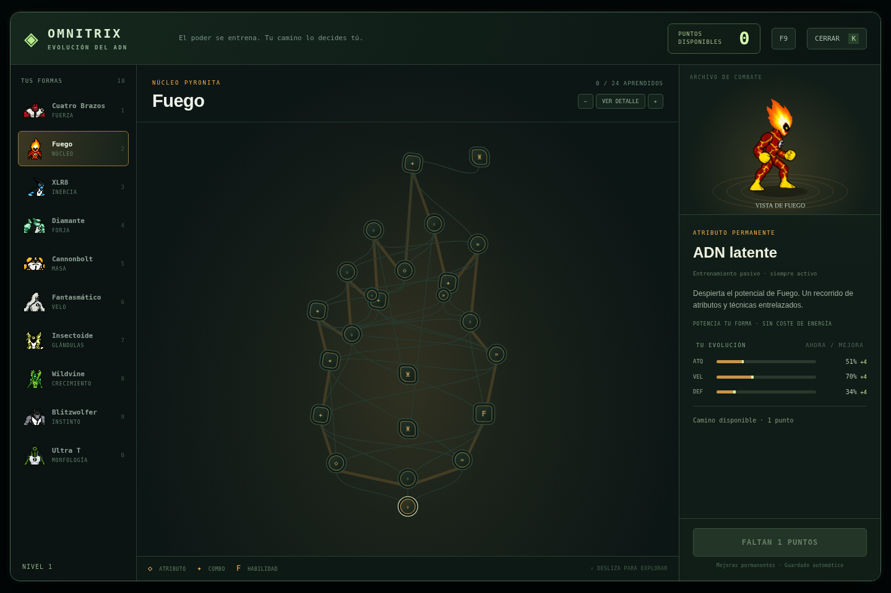
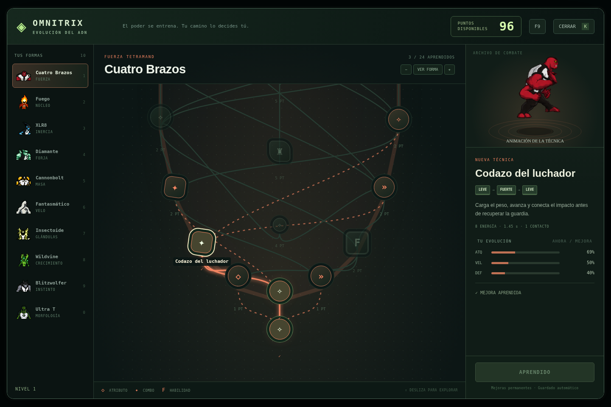

# Ben 10 · Demo PC V32

V32 amplía la última versión del usuario con árboles de ADN entrelazados y nuevos fotogramas de combate que conservan los sprites originales.

## Jugar

Abre [index.html](index.html) en un navegador de PC. Conserva la carpeta `assets`: contiene el cómic y las nuevas hojas de animación. También puedes iniciar un servidor local con `npm start` y visitar http://localhost:8000.

## Prólogo

El cómic aparece viñeta por viñeta sobre fondo blanco. Sólo muestra «Da clic» y avanza automáticamente. Clic, Espacio o Enter adelantan; Esc entra a la demo. P permite pausar y las flechas navegar.

## Evolución del ADN · K

Cada alien tiene 24 nodos y una silueta propia: círculo, llama, rayo, diamante, espiral, espectro, alas, planta, garras y circuito. Las mejoras de atributos, los seis combos y la habilidad F se mezclan en recorridos conectados, con desvíos y accesos alternativos.

La forma inicial tiene atributos limitados. Las compras mejoran realmente ataque, velocidad y defensa. Aprender un combo añade una técnica; sus nodos no regalan atributos pasivos. «Ver forma» permite ver el mapa completo; seleccionar un nodo muestra su animación, combinación, coste y requisitos. El zoom permite leer cada conexión.

Las partidas anteriores conservan nivel y XP. Los puntos gastados en los árboles anteriores vuelven a estar disponibles para redistribuirlos. El nuevo árbol se guarda automáticamente.

## Animaciones de las técnicas

Los diez aliens tienen siete clips propios: seis combos y F. Son 70 hojas PNG con 18 fotogramas para cada una de cuatro direcciones, 5.040 poses en total. Los fotogramas mantienen el dibujo de los atlas originales; se registran por el cuerpo y el suelo para conservar la escala y el regreso a la guardia.

Los impactos, presas, proyectiles y aterrizajes se sincronizan con la técnica. El codazo de Cuatro Brazos incluye impulso, el brazo recogido, contacto y recuperación. Cannonbolt se pliega y rueda; Fantasmático despliega sus tentáculos; Insectoide usa sus alas, orificios y cola; las lianas y la materia de Ultra T conservan su elasticidad.

## Controles

| Acción | Control |
| --- | --- |
| Moverse | WASD o flechas |
| Ataque leve / fuerte | Clic izquierdo / derecho |
| Dash | Espacio |
| Omnitrix y selección | R, después 1–9 o 0 |
| Volver a Ben | T |
| Árbol del alien | K |
| Habilidad aprendida | F |
| Añadir puntos para probar | F9 |

## Desarrollo y comprobaciones

- `npm test`: progresión, migración de partidas y prueba de navegador de los 70 ataques.
- `npm run build:evolution`: incrusta el catálogo, la interfaz y los sistemas editables en el HTML.
- `npm run build:skill-sprites`: reconstruye los clips a partir de los atlas originales, conserva sus píxeles al empaquetarlos e incrusta sus metadatos. Requiere Chromium, Python 3 y Pillow.
- `npm run test:legacy`: conserva las pruebas de las versiones anteriores; sus expectativas de balance e interfaz pertenecen a esas versiones.

Los sprites de juego originales y la corrección del daño de Fuego de V31 se conservan. Las nuevas hojas están en `assets/skills`, el catálogo en `assets/skills/catalog.json` y los sistemas editables en `systems/evolution-v32.js` y `systems/skill-sprites.js`.
