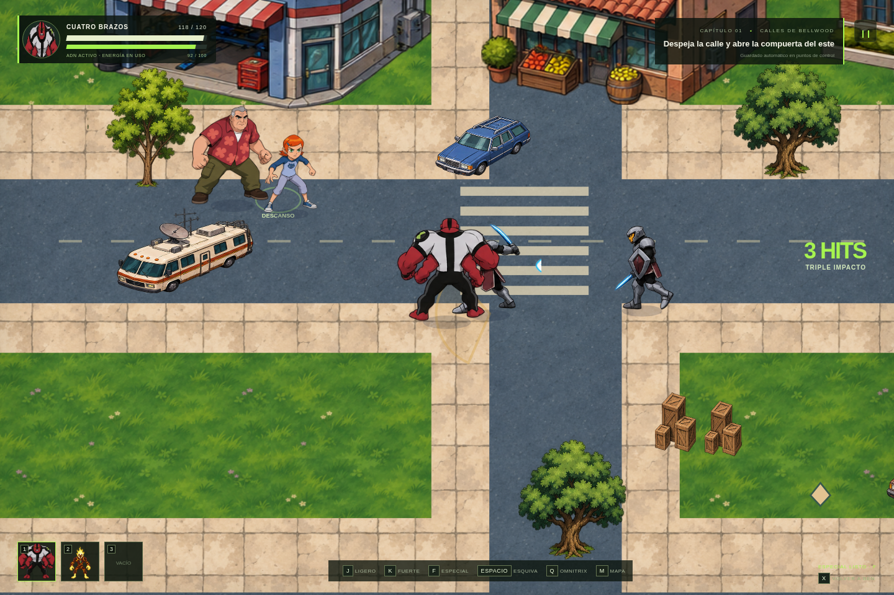

# Revisión 2.0 — ilustración y animación por fotogramas

Se retiraron `character-art.js`, `environment-art.js` y la comparativa de los modelos anteriores. Esta entrega sigue la preferencia expresa por ilustración 2D cercana al dibujo de la serie clásica.

[Ver movimiento y combate en una captura de la partida](gameplay-v2.mp4) · [Ver el mapa con M](map-v2.png)

## Arte local

`assets/characters/` contiene cinco atlas de 24 fotogramas para Ben, Fuego, Cuatro Brazos, Diamante y un caballero. Cada atlas tiene cuatro orientaciones y seis columnas: reposo, dos pasos, preparación, contacto y recuperación. El dibujo cambia de fotograma; no se deforma un muñeco vectorial ni se gira el cuerpo entero para fingir un puñetazo.

Un atlas adicional contiene a Gwen, Max, Kevin, los villanos y las variantes del Rey Eterno. Esos personajes narrativos tienen ilustraciones de pose completa; no se presentan como ciclos de movimiento completos. Las variantes de armadura de Driscoll siguen separadas por el estado de historia. Los jefes usan poses específicas y desplazamientos del motor, pero todavía tienen menos fotogramas que los personajes jugables.

Los escenarios combinan un atlas ilustrado de edificios, vehículos, árboles, mobiliario y maquinaria con texturas de césped, aceras, asfalto y piedra. Las imágenes se cargan desde el propio repositorio. No se conserva la generación geométrica de personajes y fachadas de las entregas anteriores.

## Cámara y movimiento

La cámara sigue el centro del cuerpo del jugador y no se detiene al llegar a un margen de pantalla. El terreno circundante se dibuja más allá del límite transitable para evitar bandas vacías. El zoom permite leer los personajes sin perder el espacio del combate.

El fotograma de marcha depende de la distancia real recorrida. Contra una pared se mantiene la pose de reposo. Al caminar se mira hacia el desplazamiento; al atacar o bloquear se utiliza la dirección de apuntado. Los puñetazos fijan su dirección al empezar, aplican daño una sola vez en el contacto y permiten cancelarse con la esquiva durante la preparación. Los especiales también tienen un contacto programado.

La simulación se ejecuta en pasos de 1/60 de segundo. Una caída de FPS no reduce artificialmente el ritmo del juego ni alarga los mecanismos que requieren mantener una tecla.

## Exploración

Las dos zonas urbanas miden 2600 × 1900 unidades. Hay recorridos por arriba y por abajo de las manzanas, calles que se cruzan, jardín municipal, accesos laterales y un encuentro opcional fuera de la ruta principal. El encuentro opcional no bloquea la salida. M muestra obstáculos, mecanismos, puntos seguros, salida y ubicación del jugador; mientras se consulta, el mundo queda pausado.

La campaña conserva sus compuertas, puzles y orden de capítulos: la ampliación ofrece libertad dentro de cada zona, sin eliminar los objetivos de historia.

## Procedencia y límites

Las ilustraciones se generaron para el proyecto con la herramienta de imágenes y se integraron como atlas locales. No son recursos oficiales ni se presentan como dibujos hechos manualmente por un artista de la serie. Véase [assets/README.md](../assets/README.md). El nuevo sistema es ampliable con más fotogramas de esquiva, defensa, ataques y conversación; las animaciones actuales reutilizan poses de recuperación para algunas de esas acciones.
