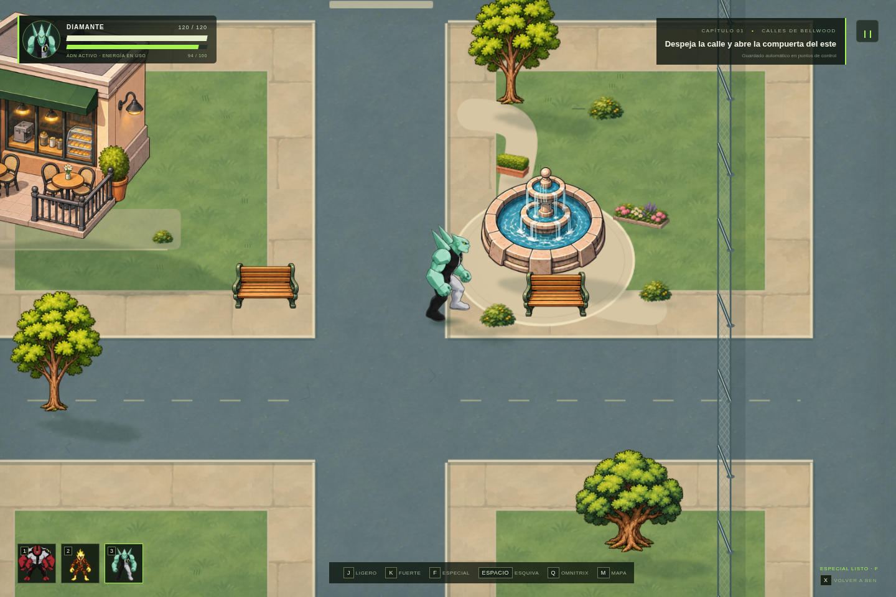
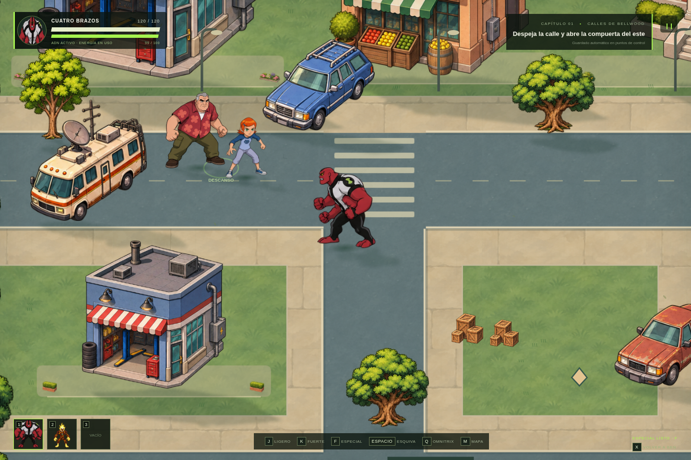
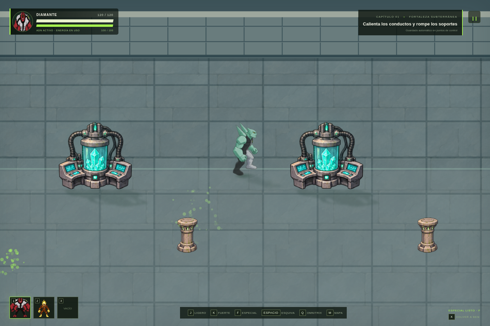
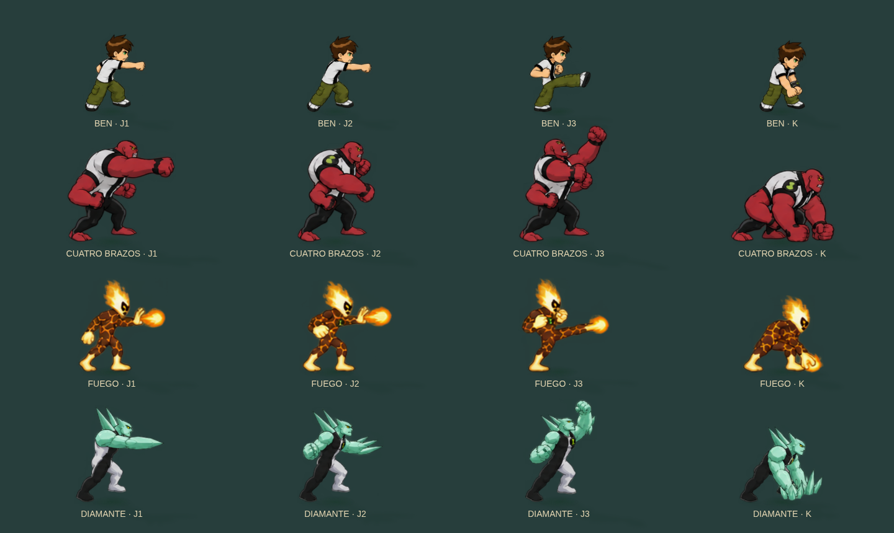

# Revisión 2.2 — escenario y variedad de combate

[Ver el clip dentro del juego](revision-v22.mp4)

## Recortes y proporciones

Las ilustraciones de escenario se renovaron con márgenes transparentes. Los cuatro edificios principales tienen una hoja dedicada. `propRect` conserva la proporción y apoya la base: un edificio, un árbol o una camioneta ya no se estiran para ocupar cualquier ancho y alto. La sombra usa exactamente el mismo encuadre. La zona de agua se calcula sobre la fuente ya ajustada.

Algunos puños de los nuevos dibujos sobrepasan las líneas nominales de la hoja. Para evitar cortar esa anatomía, `atlas-frames.js` registra cada silueta completa con un margen. El script de registro sólo calcula coordenadas; no cambia las imágenes. Las comprobaciones de navegador inspeccionan los píxeles del borde de cada fotograma y verifican la proporción de los objetos.

## Composición del escenario

- Paleta común para césped, pavimento cálido, asfalto azul gris y piedra de interiores.
- Aceras con juntas discretas, bordillos que terminan en las intersecciones y pasos de peatones.
- Edificios con plataformas de entrada, plantas y proporciones consistentes; vehículos con mayor presencia y base alineada con la calle.
- Jardín con camino curvo, plaza alrededor de la fuente, flores, setos y jardineras.
- Borde arbolado con variaciones de altura y silueta.
- Suelos interiores renovados, pasillo principal y muros continuos con hiladas y remates.

Se mantienen el agua animada, el viento, la reacción de la hierba, las pisadas, las sombras, las hojas y las luces locales. La cámara continúa siguiendo el cuerpo del jugador y el mapa conserva sus rutas y puzles.

El local de Archivos tiene suelo interior, estanterías y fachada abierta. Se verificó con teclado que la entrada y la mejora de salud siguen accesibles. [Ver el local](market-v22.png).

## Combate con poses propias

Cada forma jugable tiene tres movimientos ligeros que se recorren con J y un fuerte independiente con K. Hay preparación y contacto nuevos para cada movimiento y orientación, seguidos de la recuperación del atlas aprobado.

| Forma         | J1                   | J2               | J3               | K                         |
| ------------- | -------------------- | ---------------- | ---------------- | ------------------------- |
| Ben           | Jab                  | Cruzado          | Patada           | Golpe con ambos puños     |
| Cuatro Brazos | Puño superior        | Gancho inferior  | Puño ascendente  | Golpe al suelo            |
| Fuego         | Palma adelantada     | Palma opuesta    | Patada con llama | Golpe al suelo con fuego  |
| Diamante      | Estocada de cuchilla | Revés de cristal | Uppercut         | Golpe cristalino al suelo |

El avance del cuerpo, las estelas y la variación de sonido acompañan el tipo de ataque. El daño conserva un único instante de contacto y una dirección fijada al empezar. La esquiva sigue cancelando el ataque pendiente. Estas poses amplían los tres alienígenas jugables y Ben; no añaden combate para los ADN bloqueados ni animaciones nuevas al reparto narrativo.

## Verificación

31 pruebas de sistemas y 27 comprobaciones de navegador cubren la selección y reinicio de combos, el daño por contacto, los fotogramas distintos en cuatro direcciones, los bordes de los recursos, las proporciones, la marcha, el agua, el viento, las rutas, el guardado y el capítulo completo. No hubo errores de página. La prueba opcional con `file://` continúa omitida por la política del navegador administrado.

El clip usa los controles reales. La colocación de los encuentros y el acceso a Diamante se preparan explícitamente para mostrar las cuatro formas sin recorrer de nuevo todo el capítulo. Los fondos estáticos y los escalados se reutilizan en caché. La simulación sigue a 60 Hz; la frecuencia de dibujo depende del equipo.
