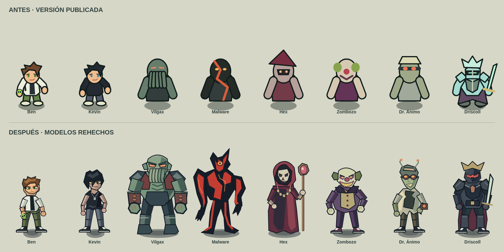

# Revisión visual 1.1

Esta revisión reemplaza los dibujos de los personajes publicados en el primer commit (`b82394c`). La imagen compara las dos versiones dibujadas por sus renderizadores reales, con la misma escala de mundo y sin recursos promocionales sustituyendo a los sprites.

## Cambios concretos

- Ben conserva diez años, camiseta blanca y negra, pantalones verdes y el reloj en la muñeca izquierda. La cabeza deja de ser un círculo; tiene mandíbula, esclerótica, iris, nariz, cejas y boca con expresiones. El cuello queda separado de los hombros y el torso, sin la espalda encorvada de la versión anterior. La pose del menú levanta el reloj.
- Kevin tiene su propio dibujo: cuerpo más delgado y alto, pelo negro largo que cae sobre la cara, ojos hundidos, camiseta sin mangas, pantalones grises y colgante. No reutiliza el cuerpo ni la cara de Ben.
- Vilgax tiene una escala y anchura superiores a las de los niños, antebrazos implantados, armadura oscura, rostro cefalópodo y ojos estrechos. Los tentáculos tienen volumen y trazos internos; desaparecen los ojos redondos y el cuerpo pequeño.
- Malware usa una silueta alta, asimétrica y angulosa, un sensor único y circuitos rojos sobre una masa negra. No comparte la plantilla humanoide genérica de los otros villanos. Se utiliza su aspecto rojo de Mechamorph corrupto, adaptado a la continuidad alternativa solicitada.
- Hex tiene capucha roja, maquillaje de calavera, bastón y amuletos; se elimina el sombrero puntiagudo de mago genérico.
- Zombozo tiene chaqueta y pantalones púrpuras, chaleco, maquillaje oscuro, pelo lateral verdoso y sonrisa con dientes; deja de ser una cara redonda alegre.
- Ánimo tiene gafas, transmodulador, antenas, cara alargada, bata deteriorada y aparato de muñeca.
- Driscoll utiliza metal oscuro y ribetes de bronce en el prólogo. Las placas de cristal se añaden únicamente durante la fase de armadura del jefe y desaparecen al romperse. Tanto los retratos como el escenario usan la misma regla narrativa.
- Gwen, Max, Fuego, Cuatro Brazos, Diamante y los caballeros también se redibujaron para mantener las mismas proporciones, contornos y sombreado.

## Animación y escenarios

Cada dibujo usa articulaciones, no una imagen estática rotada. La marcha alterna rodillas y apoyo de los pies; las acciones cambian codos, manos y torso. Se distinguen postura de guardia, ataque, esquiva y habilidades especiales. Cuatro Brazos alterna brazos y eleva los puños antes de su golpe de suelo. Los retratos tienen encuadre propio y no usan una ampliación arbitraria del sprite completo.

La ciudad tiene asfalto azul grisáceo, aceras cálidas, fachadas con profundidad, cristales reflejantes, sombras proyectadas, alcantarillas, rejillas y señalización pintada. La fortaleza usa piedra fría, alfombra del trono y reflejos de los mecanismos. El grano de las superficies se genera una vez y se conserva en caché para evitar parpadeos; los trazados vectoriales se reutilizan mediante `Path2D`.

## Referencias consultadas y alcance

- [Ben10 Wiki, repositorio comunitario](https://github.com/DevaMhatre/ben10-wiki): se consultaron sus imágenes de la serie clásica para la camiseta, el reloj y la silueta infantil de Ben. Sus imágenes de Alien Force no se usaron para convertirlo en adolescente.
- [Ben 10 Encyclopedia, repositorio comunitario](https://github.com/ramdineshr87-lang/ben10-encyclopedia/blob/main/js/data.js): se contrastaron identidad y rasgos narrativos como el rostro cefalópodo de Vilgax, Kevin de once años, maquillaje de calavera de Hex, transmodulador de Ánimo y naturaleza Mechamorph de Malware. Es una fuente secundaria, no una hoja de modelos oficial.
- Se intentó consultar las fichas de Fandom, pero la política de red del entorno impidió abrirlas. No se afirma haber visto esas fichas ni sus galerías.

Los trazados son dibujos locales hechos en código. No se incorporaron imágenes de esos repositorios, capturas oficiales ni recursos externos al juego. Los diseños siguen siendo una interpretación vectorial estilizada, no una reproducción exacta de los modelos de producción de la serie. La comparación está incluida para que el resultado se pueda revisar visualmente.
