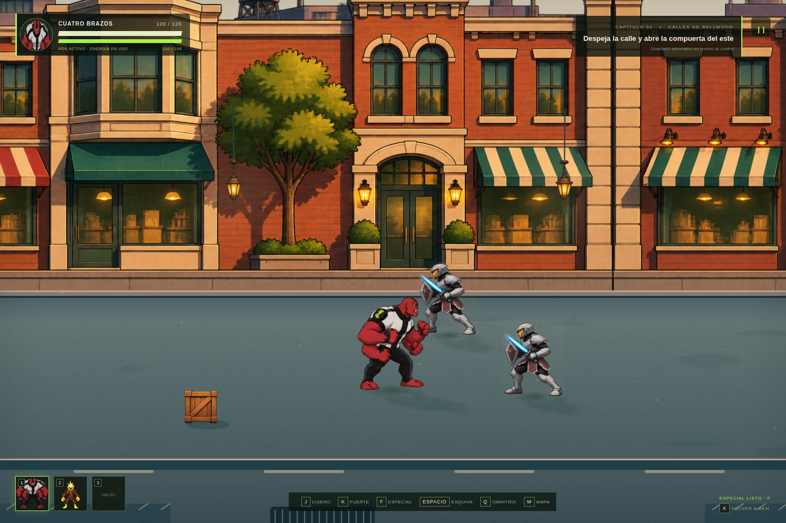
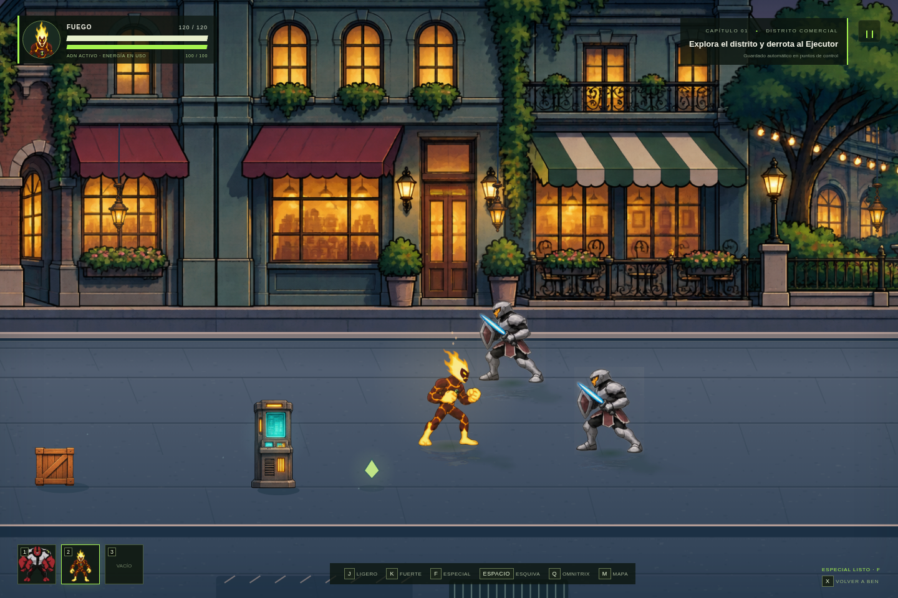
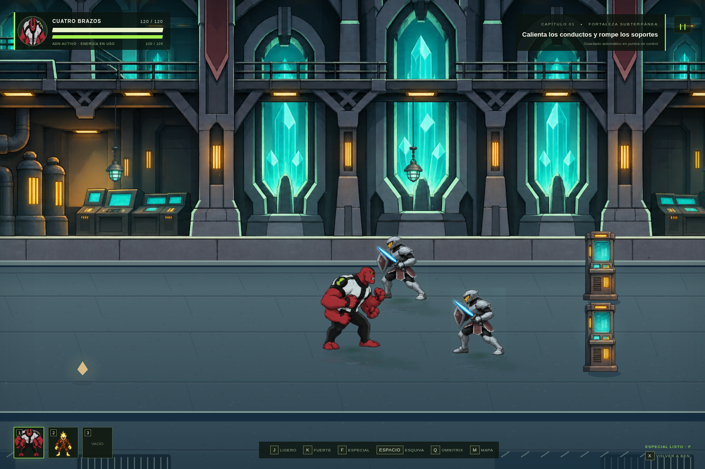
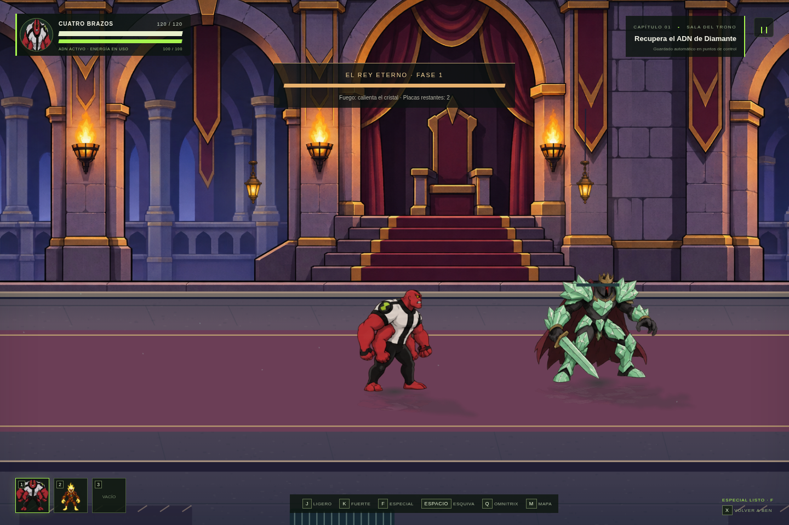
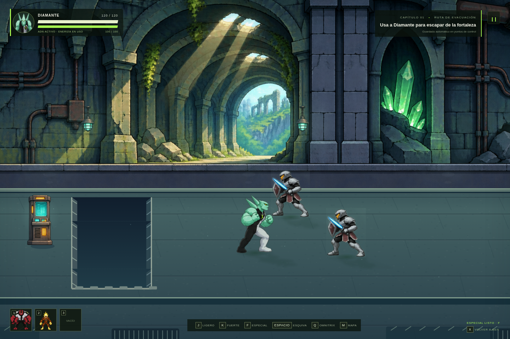
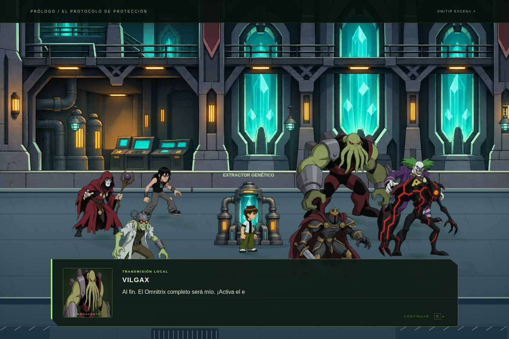

# Versión 3.0 — mundo lateral

[Ver el vídeo de juego](lateral-gameplay.mp4) · [Referencias consultadas](references.md)

## Perspectiva y movimiento

El capítulo se reconstruyó como beat ’em up lateral. La cámara acompaña el avance horizontal; W/S mueven los pies hacia el fondo o hacia la cámara sin cambiar su altura. Los actores miran a izquierda o derecha y se ordenan según la posición de sus pies.

Las colisiones pertenecen a la banda del suelo. Los edificios quedan detrás de ella. Las cajas, columnas y mecanismos tienen una huella de colisión y un dibujo apoyado sobre esa huella. Los golpes necesitan una profundidad similar, y la IA busca alinearse antes de preparar un ataque. El mapa representa la nueva ruta y sus secretos.

## Escenarios reconstruidos

Cada zona tiene un panorama arquitectónico completo, una paleta y un suelo propios. Cielo y siluetas lejanas, arquitectura intermedia, actores y elementos de primer plano se desplazan a distinta velocidad. Los módulos de arquitectura se enlazan con apoyos en sus uniones.

El suelo utiliza luz y textura discretas para que los pies y las siluetas se lean claramente. Las sombras de contacto, la luz de ambiente aplicada a los actores, las pisadas y los reflejos suaves integran los cuerpos en el escenario. No se rota un personaje completo para simular que golpea.

Las lámparas oscilan con el viento del mundo; su luz varía. La calle tiene una fuente con caídas y ondas, la Rustbucket emite humo tenue y los interiores tienen vapor y motas. Fuego proyecta un resplandor animado y pequeñas chispas. Estos efectos continúan durante las conversaciones y se detienen al pausar o abrir el mapa.

## Personajes y encuadres

Ben, Fuego, Cuatro Brazos, Diamante y los caballeros tienen nuevas hojas de reposo, guardia y marcha lateral, con dos orientaciones y seis poses de paso. La marcha sigue la distancia real recorrida. El diseño de los personajes conserva la identidad aprobada.

Se reutilizan las orientaciones laterales de los cuatro movimientos de combate: tres ligeros y un fuerte. Cada movimiento tiene preparación y contacto propios, seguidos de recuperación. Los proyectiles se presentan a la altura de manos o pies según el ataque.

Los encuadres se calculan por la silueta completa de cada pose. Las imágenes de objetos conservan su proporción y dejan un margen transparente. Las pruebas inspeccionan sus bordes para detectar anatomía o mobiliario cortados. Los panoramas son paños continuos que ocupan la anchura de su módulo; sus extremos son uniones arquitectónicas deliberadas.

Los personajes narrativos conservan poses ilustradas y respiración sencilla, con el nuevo apoyo de pies y luz de escena. No se añaden ciclos completos de actuación o sincronización labial.

## Validación

Pasaron 34 pruebas de sistemas y 31 comprobaciones en Chromium, incluyendo la secuencia completa hasta recuperar Diamante y terminar el escape. Se probaron encuadres, marcha, golpes según profundidad, límites del suelo, accesibilidad de rutas y secretos, cámara horizontal, luz ambiental, desplazamiento de panoramas, guardado y pausa. No hubo errores de página. La modalidad opcional con `file://` se omitió por la política del navegador administrado.

El vídeo utiliza controles reales; los encuentros y cambios de zona se colocan explícitamente para mostrar el capítulo en un clip breve. Los fondos estáticos, escalados, sombras y versiones iluminadas se reutilizan en caché. La simulación mantiene pasos de 60 Hz; no se garantiza la misma frecuencia de dibujo en todos los equipos.
