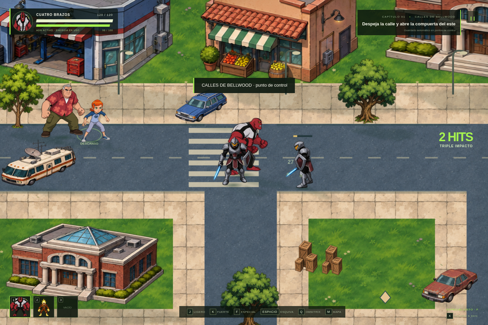

# Revisión 2.1 — integración, movimiento y ambiente

Se conservan los modelos y la identidad visual de la versión 2.0. Los archivos originales de personaje, reparto y escenario no se han sustituido.

[Ver el clip de movimiento, combate y jardín](integration-v21.mp4) · [Ver el jardín y la fuente](garden-v21.png)

## Movimiento y combate

Los cinco ciclos complementarios `*-walk.png` usan seis poses consecutivas por orientación. Se eliminó la alternancia entre paso y reposo que cortaba la marcha. Cada fotograma se registra sobre la pelvis y los pies; el tamaño del cuerpo no depende de hasta dónde se extiende una mano.

En reposo, el pecho respira sin despegar las piernas del suelo. Al acercarse enemigos se adopta una pose de guardia. La esquiva tiene elevación y aterrizaje, con la sombra permaneciendo sobre el suelo. El avance del golpe y el retroceso al recibir daño se distribuyen en varios pasos de simulación y respetan las colisiones. Los impactos pueden interrumpir las preparaciones de los caballeros comunes.

Las pisadas se sincronizan con el ciclo y la distancia real recorrida. Según la superficie, producen una marca breve, polvo o hierba y un sonido suave. No se generan al quedarse empujando una pared. El daño sigue ocurriendo una sola vez en el contacto del ataque, y la esquiva puede cancelar una preparación.

Los modelos originales se mantienen para reposo y combate. Los personajes narrativos tienen respiración sutil sobre sus poses existentes; no se afirma que tengan ciclos completos de gestos o sincronización labial. Defensa y algunas recuperaciones reutilizan poses del atlas aprobado.

## Profundidad y ambiente

- Personajes, edificios, vehículos y árboles proyectan sombras con una dirección de luz común. Los personajes tienen sombra de apoyo bajo los pies.
- La copa de los árboles se mueve con el viento manteniendo el tronco anclado. La transparencia para ver al jugador se aplica a la copa que realmente lo tapa.
- La hierba se inclina ante el viento y al pasar cerca un personaje. Hojas y pequeñas siluetas de aves aportan movimiento ambiental.
- Las fuentes tienen corrientes, gotas y ondas recortadas sobre el agua de la ilustración. La piedra y la estructura permanecen inmóviles.
- Farolas, máquinas y mecanismos tienen luces locales. La Rustbucket emite humo tenue y Fuego ilumina su entorno.
- Se recolocaron edificios, bancos y la fuente que ocupaban calzadas; los cruces y bordillos respetan el trazado de las calles.
- Las vallas usan malla transparente, postes y apoyos con sombra para que el suelo se vea entre ellos.

Las marcas y los efectos se mantienen en una capa visual acotada, independiente del guardado, la salud y la misión. El tiempo del mundo detiene el agua y el viento durante la pausa. La cámara sigue centrada en el jugador y M permite consultar el mapa.

## Rendimiento y validación

Los fondos estáticos se componen una vez por zona. Siluetas, sombras y versiones escaladas se guardan en caché, y se omiten objetos fuera de la cámara. El HUD se actualiza a una frecuencia menor que la simulación; el control y las colisiones siguen ejecutándose en pasos de 60 Hz. Esto no garantiza 60 FPS en cualquier equipo.

Pasaron 29 pruebas de sistemas y 24 comprobaciones en Chromium. Se verificaron el ciclo sin reposo intercalado, el apoyo de los troncos, el agua animada, las sombras, las pisadas y su caducidad, el retroceso gradual, las rutas y la secuencia completa del capítulo. La apertura opcional con `file://` continúa sin verificarse por la política del navegador administrado.

Las imágenes complementarias se generaron a partir de los modelos aprobados; el movimiento, las sombras y las reacciones del entorno se implementan en el motor. Véase [assets/README.md](../assets/README.md).
