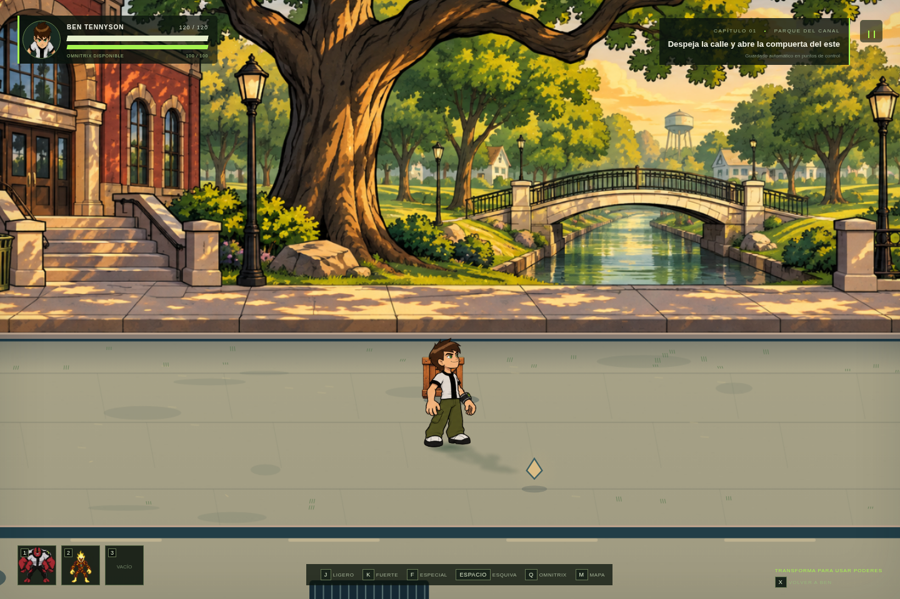
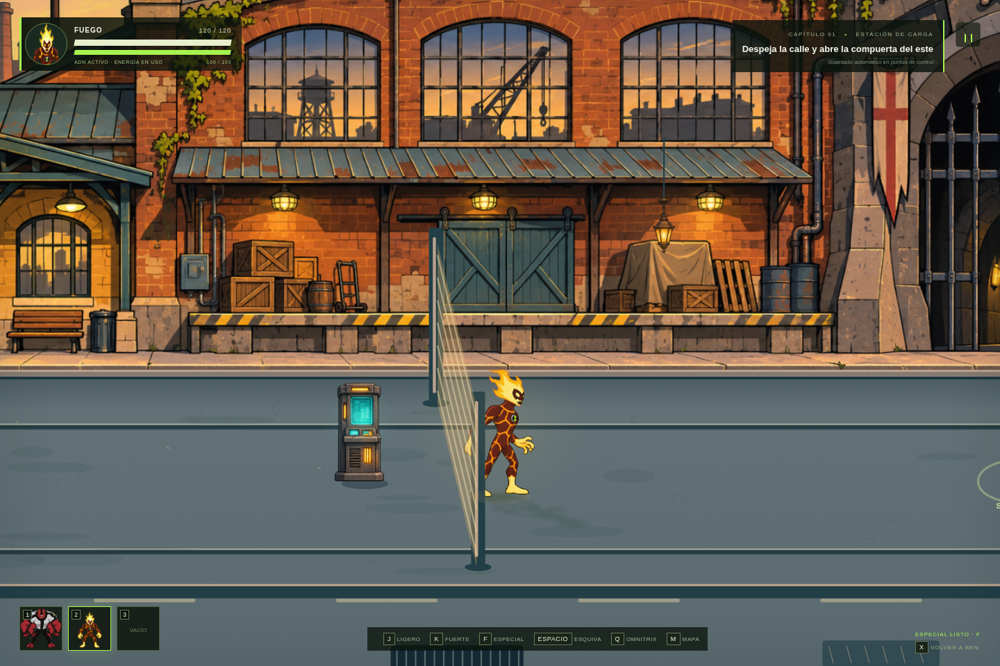
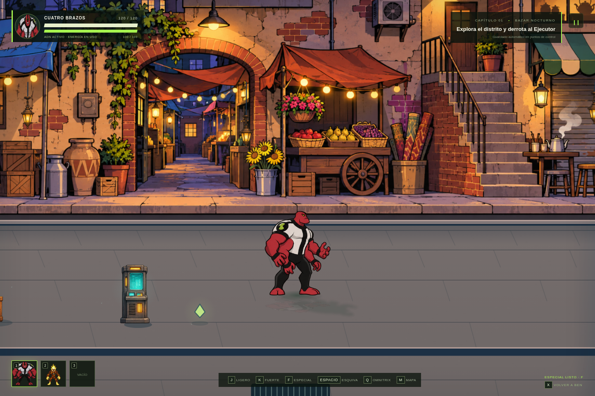
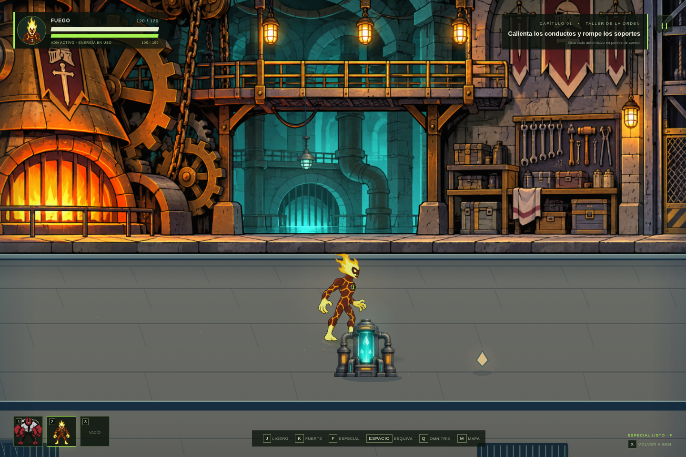
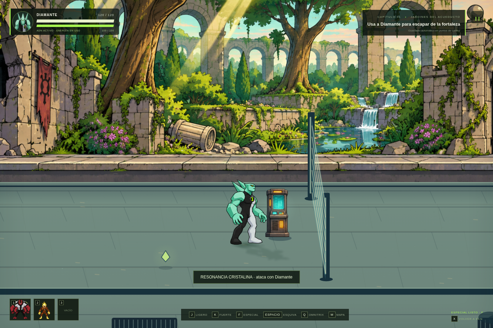
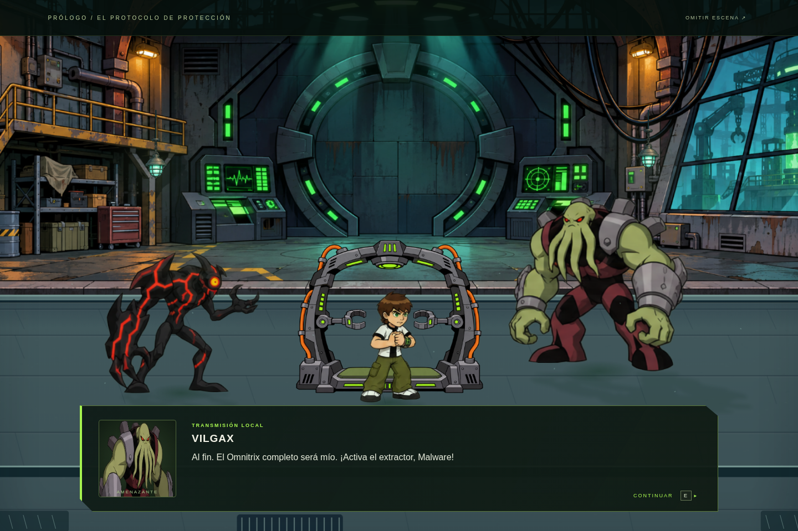

# Versión 4.0 — actuación y recorridos únicos

[Ver la revisión en movimiento](motion-gameplay.mp4) · [Referencias consultadas](references.md)

## Un recorrido con lugares distintos

La arquitectura ocupa posiciones fijas y cada panorama se usa una sola vez por recorrido. El barrio de Bellwood desemboca en un parque con canal y después en una estación de carga. El mercado reúne galería comercial, bazar nocturno y plaza del Ejecutor. La fortaleza pasa de la energía cristalina a los talleres mecánicos y al salón de estandartes. Tras el trono, el corredor derrumbado termina en los jardines abiertos del acueducto.

Los extremos de cada pintura se solapan con una máscara suave. El suelo cambia de color y material según el tramo: adoquines, sendero y raíles aportan hitos propios. Las lámparas y los elementos de primer plano tienen posiciones elegidas para cada lugar. La profundidad sigue siendo transitable y los edificios quedan detrás de las colisiones de los pies.

## Un prólogo propio

El laboratorio industrial tiene su propio fondo, una máquina de extracción abierta y luces electrónicas. No usa el reactor cristalino ni el panorama de la fortaleza. Los encuadres muestran al interlocutor y un acompañante; los personajes escuchan, gesticulan y reaccionan con dibujos diferentes. La fractura libera las firmas genéticas y provoca la pelea. Ben forcejea, se protege, se levanta y huye con desplazamiento continuo. Driscoll conserva su armadura original hasta el encuentro del trono.

El reparto tiene 60 dibujos de actuación repartidos en dos hojas: Vilgax, Malware, Kevin, Hex, Zombozo, Dr. Ánimo, Driscoll, Ben, Gwen y Max. Los gestos son actuación por poses; no hay doblaje ni sincronización labial fonética.

## Reposo, guardia y golpes

Ben, Fuego, Cuatro Brazos y Diamante tienen cuatro dibujos de reposo y cuatro de guardia por personaje, con parpadeo, manos, rodillas y cambios de peso. Cada uno tiene además 24 dibujos nuevos de ataque: tres ligeros y un fuerte, con seis fases por movimiento. Las orientaciones se reflejan alrededor del apoyo del cuerpo, conservando el contacto de los pies. La marcha mantiene seis poses y avanza con la distancia real recorrida.

El Ejecutor y las dos apariencias de armadura del Rey tienen otras 18 poses: guardia, cambio de peso, preparación, contacto, reacción y paso. Los caballeros alternan guardia y usan sus ciclos de marcha y ataque. Las reacciones no giran el recorte completo del personaje.

**Fuego** es más ágil que Cuatro Brazos: velocidad 255 frente a 185, ligero de 0,22 frente a 0,32 s, y espera entre esquivas de 0,56 frente a 0,86 s. J tiene tres contactos físicos distintos. K carga fuego y lo libera desde las manos, con estela y núcleo de llama. La dirección queda fijada al iniciar el golpe y el daño se aplica una sola vez al contacto.

Los destellos aparecen a altura del cuerpo, con retroceso y una pausa de 23 ms al acertar un ligero o 50 ms en uno fuerte. La defensa reduce el efecto. Las sombras, la luz de ambiente, los reflejos y los contactos con el suelo integran los sprites en el escenario.

## Validación

Pasaron **38 pruebas de sistemas y 34 comprobaciones en Chromium**, sin errores de página. La comprobación opcional con `file://` se omitió por la política del navegador administrado. Las pruebas comprueban los límites de cámara durante el diálogo, rutas sin repetición, geometría del suelo, comportamiento de Fuego, huida gradual, seis poses por golpe, actuación del reparto, bordes de los atlas, mecanismos, guardado y la secuencia completa del capítulo. El vídeo de revisión combina controles reales con colocación explícita de los encuentros y cambios de zona para mostrar la revisión en un clip breve.

Los fondos, versiones escaladas e iluminadas, sombras y suelos se guardan en caché. La simulación usa pasos de 60 Hz; la frecuencia de dibujo depende del equipo.
